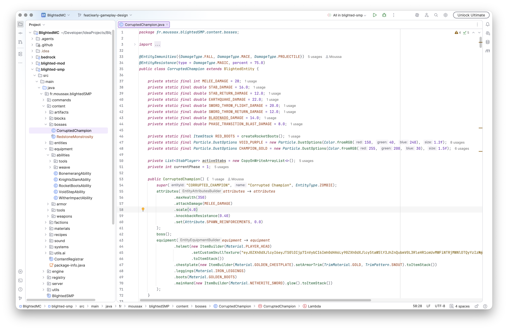
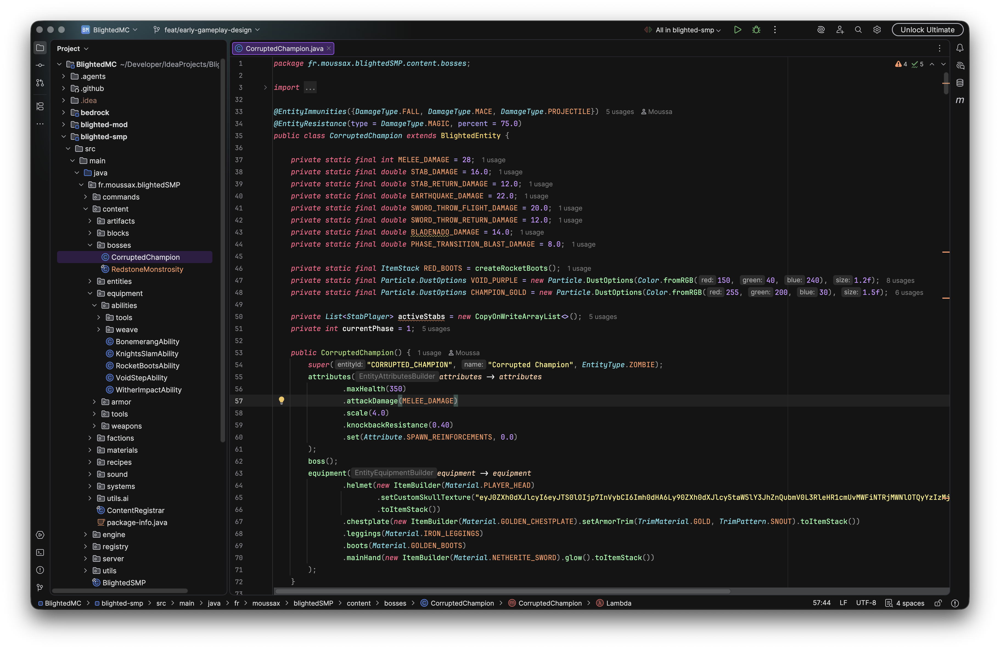
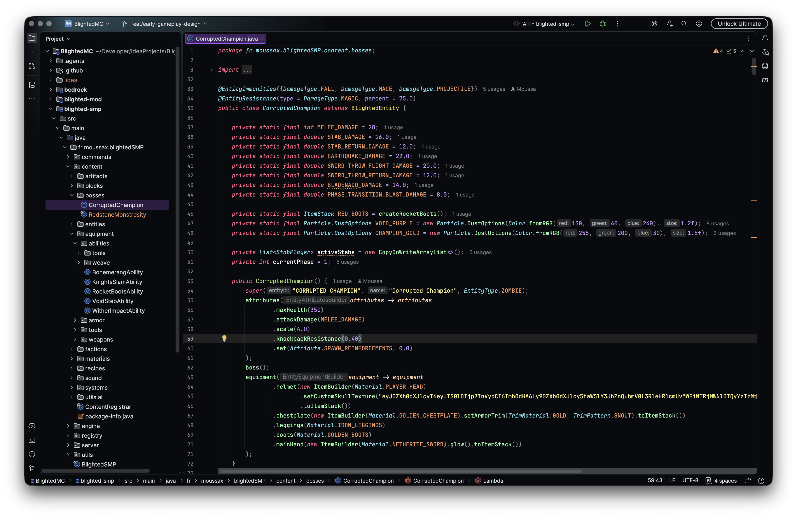
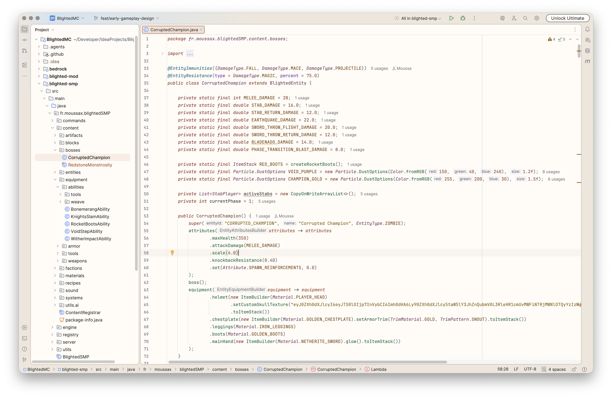
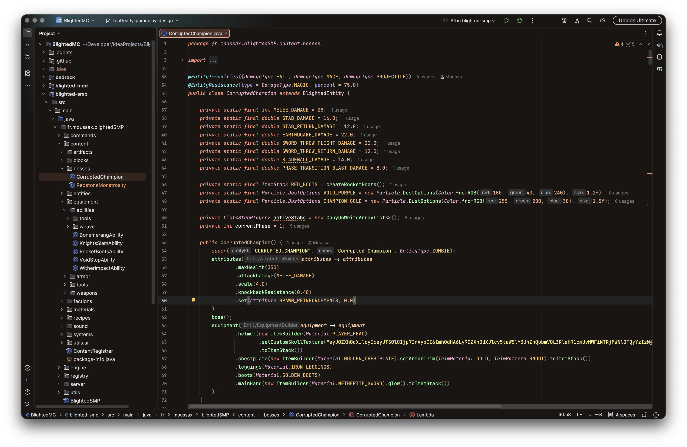
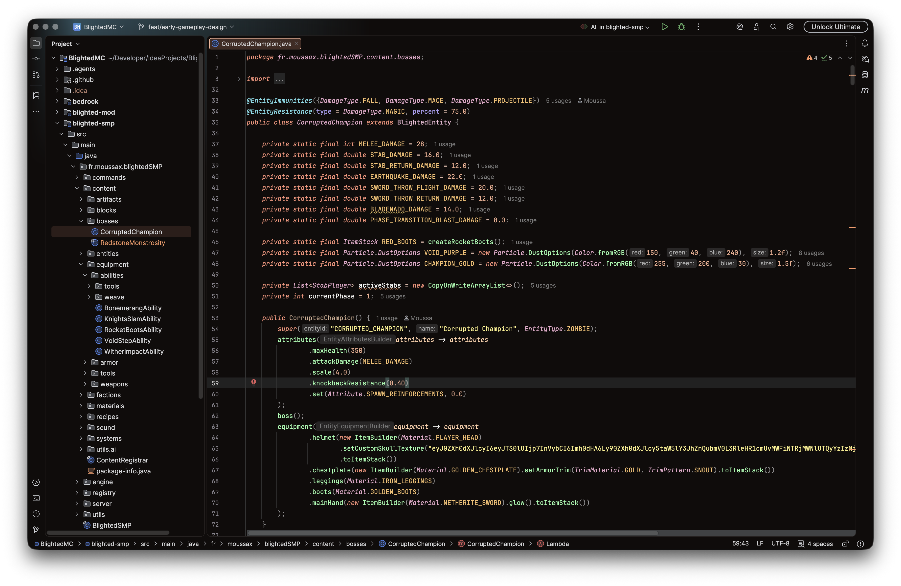
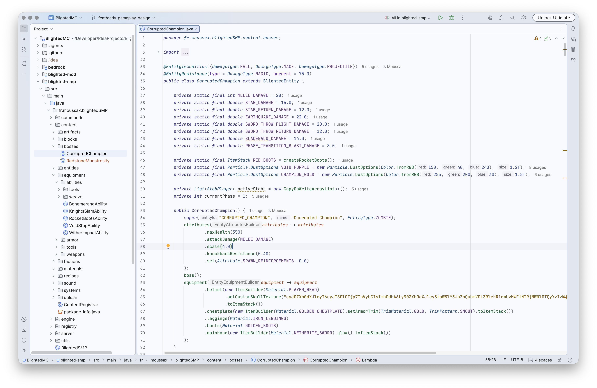
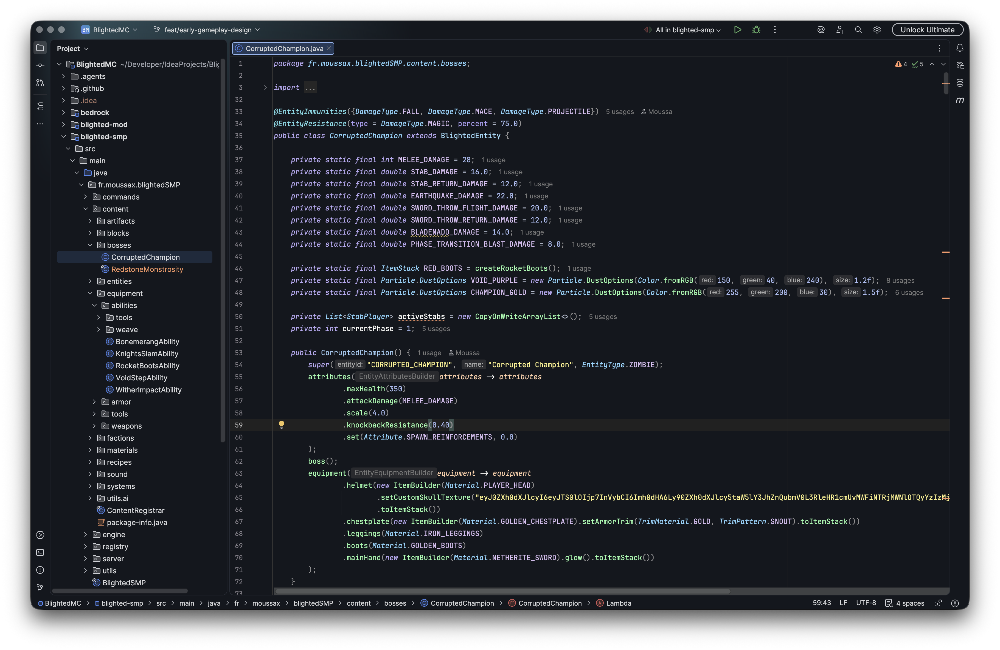
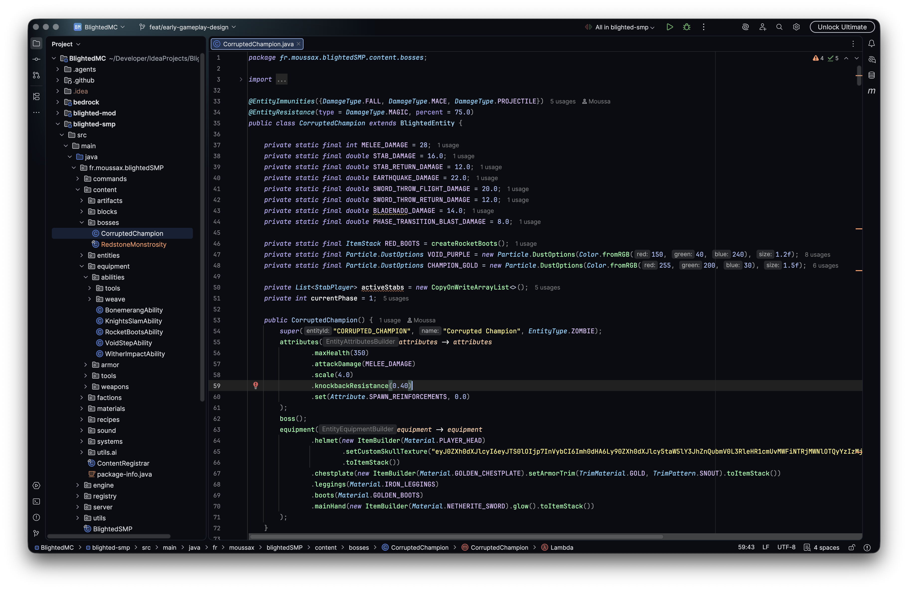

# Lotus Islands Theme

Lotus Islands Theme brings nine UI themes and matching editor color schemes to JetBrains IDEs with the Islands UI (2025.3+). The palettes share readable syntax, visible keyboard focus, and clear borders around editor and tool-window islands.

## Themes

| Palette | Light | Dark | Midnight |
| --- | --- | --- | --- |
| **Lotus**: Violet accents and neutral surfaces | Lotus Light | Lotus Dark | Lotus Midnight |
| **Copper**: Terracotta accents, warm surfaces, and bronze function declarations | Lotus Copper Light | Lotus Copper Dark | Lotus Copper Midnight |
| **Iridium**: Steel-blue accents, cool slate surfaces, and indigo keywords | Lotus Iridium Light | Lotus Iridium Dark | Lotus Iridium Midnight |

Light uses a nearly white editor, Dark uses charcoal, and Midnight uses a near-black canvas.

## Installation

1. In your IDE, open **Settings → Plugins → Marketplace**.
2. Search for **Lotus Islands Theme** and install it.
3. Open **Settings → Appearance & Behavior → Appearance** and choose a Lotus theme.

## Screenshots

| Palette | Light | Dark | Midnight |
| --- | --- | --- | --- |
| **Lotus** |  |  |  |
| **Copper** |  |  |  |
| **Iridium** |  |  |  |

## Release notes

See the [changelog](CHANGELOG.md) for changes in each release.

## Credits

The original Lotus palette was created by Brian Lai. The editor schemes include colors from [Rainbow Brackets](https://plugins.jetbrains.com/plugin/10080-rainbow-brackets).

